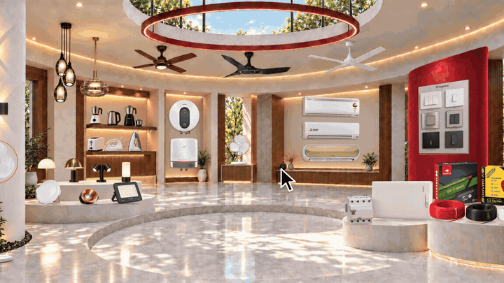

<div align="center">

# launch<span style="color:#FF5A1F">.</span>

**A Claude Code skill that turns your brand's photos into a beat-synced launch film.**
One command. One continuous take. Every scene morphs out of the last, right on the beat.



<!-- To show the full film with a play button: edit this README on GitHub, drag
     launch-film-github-1920x1080.mp4 (under 10 MB) onto this line, and commit. -->

</div>

---

## What it makes

A 15–30 second advert for Reels, Shorts, X and LinkedIn that looks like a product keynote:

- **One continuous take.** Nothing fades, blurs or cuts. Shapes change into the next scene: a wordmark squeezes into its own period, the dot becomes a pill, the pill becomes a panel, a photo becomes a glass orb, the orb becomes a phone.
- **On the beat.** It measures the song's tempo and drop, then puts something on every beat and lands the big camera zoom exactly on the drop.
- **A cursor drives everything,** with real clicks, drags and long-presses, and a screen-studio camera that zooms so each moment fills the frame.
- **Liquid glass, goo merges, a six-blade iris, morphing pills.**
- **It loops.** The last frame equals the first, so the Reel plays forever.

## How you use it

```text
/launch-film
```

Claude asks one round of questions, each with a sensible default:

| You pick | Options |
|---|---|
| Vibe | Keynote Clean · Night Premium · Festive · Technical Pro · Desi Playful · Editorial Bold · Brand-led |
| Story | Journey · Problem → Fix · Compare · Feature tour · Occasion · Brand story · Explainer |
| Format | 9:16 · 1:1 · 4:5 · 16:9, about 15 s or 30 s |
| Signature move | Three interactions made for your product (a dimmer that relights a room, a feed that fills with posts…) |
| Language | English, Hinglish, Hindi, or the language you write in |

You drop in 9–12 of your own photos and pick a free song. You can also give it a video whose look you like, or an article to turn into a film. Before building the full film, you get a beat map and five stills to approve.

You get an editable `film.html`, the MP4, the soundtrack and a `claims.md`.

## Two hard rules

1. **Zero cost.** Free assets and tools only: Mixkit music and sound effects, Pexels and Pixabay footage, Google Fonts, Playwright, ffmpeg. If something would cost money, it stops and offers a free route.
2. **Honest claims.** Every price, spec and offer on screen needs a source, and each one goes into `claims.md`. No fake reviews, prices, discounts or urgency.

Every brand also gets a profile (wordmark, colours, fonts, end card), and the skill keeps a history so your next film never repeats the last one's vibe, song or opening.

## Install

You need [Claude Code](https://claude.com/claude-code), Node.js 18+, ffmpeg on your PATH and Google Chrome.

```bash
git clone https://github.com/maisonlumiere/launch-film ~/.claude/skills/launch-film
```

On Windows, clone into `%USERPROFILE%\.claude\skills\launch-film`. Then, in the folder where you want your films:

```bash
npm install playwright-core
```

Start Claude Code there and type `/launch-film`.

## The example film

[`examples/skill-ad/`](examples/skill-ad) is the complete, editable film from the preview above: the engine (springs, per-pixel liquid glass, smooth-min goo, cursor and camera), 16:9 and 9:16 versions, the render and QA script, the sound mix, and its `claims.md`. Start your own films from it.

## Credits

- Inspired by **[@twoclipping](https://x.com/twoclipping)** and his keynote-style launch film prompt, which this skill grew out of.
- Example film music: "I Do!" by Michael Ramir C. via [Mixkit](https://mixkit.co) (Mixkit Stock Music Free License; not included in this repo).
- Example film sound effects: CC0 sounds by [Kenney](https://kenney.nl) and Freesound creators.
- Fonts: Archivo and Geist Mono (SIL Open Font License).
- Example photos: Electric Emporium, Balaghat, used with the owner's permission.

## License

[MIT](LICENSE). The example photos and the Reel frames in `examples/skill-ad/assets` belong to their owners and are only for running the example.
